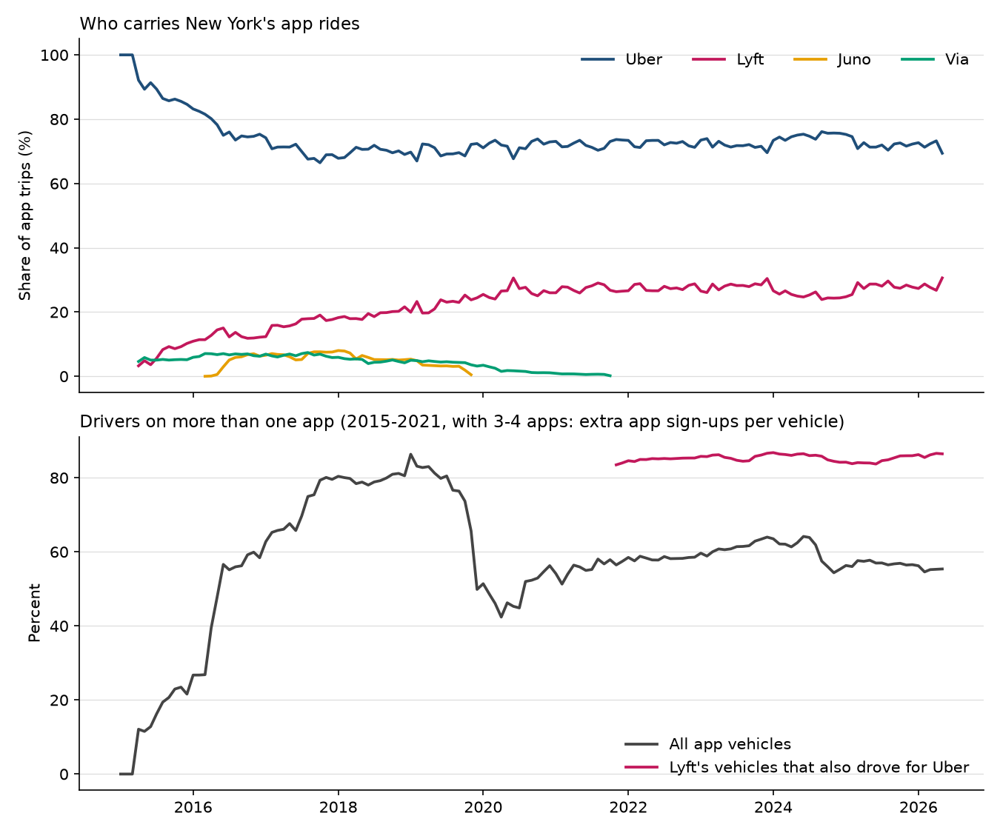
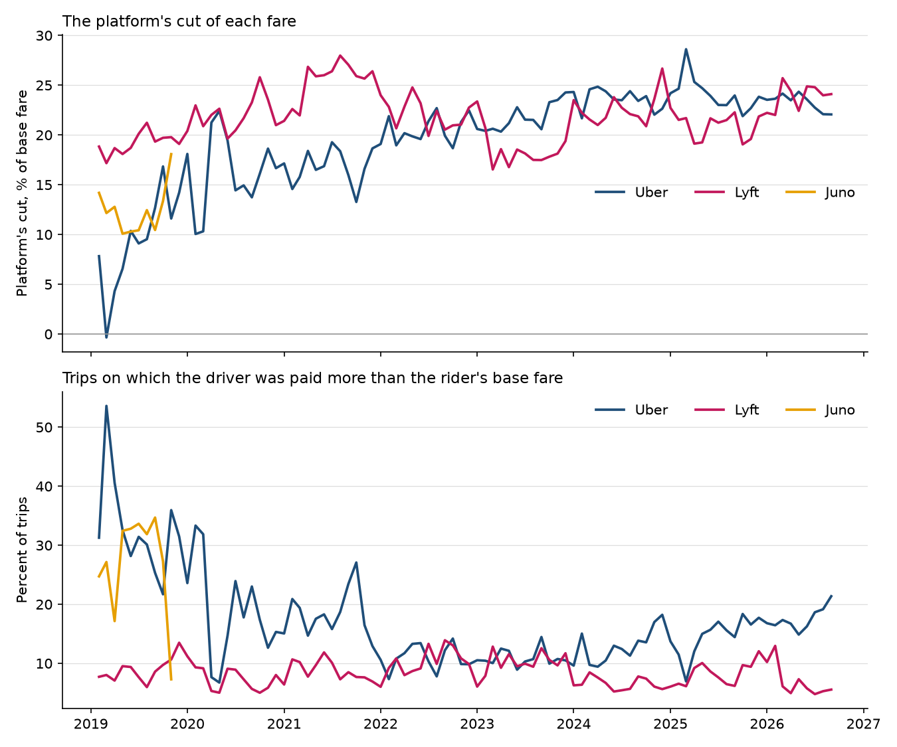

# The Second App

### In 2003, Bernard Caillaud and Bruno Jullien asked what happens when middlemen compete to connect two groups that each need the other. I asked again, using 1.6 billion app rides in New York City.

---

Most cars that pick up app riders in New York work for both Uber and Lyft. In May 2026, 77,541 cars took at
least one trip for Uber and 54,380 took at least one for Lyft, but only 84,907 distinct cars did any app trip at
all. The difference, 47,014 cars, drove for both. A driver waiting outside Penn Station takes whichever request
arrives first, and a rider standing on the curb opens both apps and compares prices.

What each company keeps from the fare has changed a great deal. On the average Uber trip in 2019 the rider paid a
base fare of $18.96 and the driver was paid $17.16, so Uber kept $1.80. On a third of its trips that year, Uber
paid the driver more than the rider paid. By 2025 the average fare was $28.02, the driver got $21.25, and Uber
kept $6.77. Two other apps, Juno and Via, had come and gone in between.

A market like this has a chicken-and-egg problem. Riders want the app with the most drivers nearby, and drivers
want the app with the most riders. Two economists, one in Paris and one in Toulouse, worked out how middlemen compete when both sides of the
market behave this way, and what changes when people are free to use more than one. New York's taxi regulator
publishes enough data to check their answer.

---

## Two measures

The first measure is the platform's cut, the share of the rider's base fare that the company keeps after paying
the driver. Writing $`F`$ for the base fare and $`D`$ for driver pay, summed over trips,

```math
\tau = 1 - \frac{D}{F}
```

The fare is before tolls, tips, taxes and surcharges, which pass through to others. For Uber's trips in 2025:

```math
\tau_{\text{Uber},\,2025} = 1 - \frac{\$21.25}{\$28.02} = 1 - 0.758 = 0.242
```

So Uber kept 24.2 cents of every dollar of base fare. A trip with $`\tau < 0`$ is a subsidized match, one on which
the platform paid the driver more than the rider paid.

The second measure is multihoming, the share of cars that work for more than one app in the same month. The New
York City Taxi and Limousine Commission reports how many distinct cars did trips for each company, $`V_k`$, and how
many did any app trip at all, $`V`$. With two companies, a car counted by both is a car on both apps:

```math
m = \frac{V_{\text{Uber}} + V_{\text{Lyft}} - V}{V}
```

For May 2026:

```math
m = \frac{77{,}541 + 54{,}380 - 84{,}907}{84{,}907} = \frac{47{,}014}{84{,}907} = 0.554
```

Measured against Lyft's fleet instead, 47,014 of 54,380 cars, or 86.5%, also drove for Uber that month.

| Share of cars on both apps | What it looks like | Caillaud and Jullien's case |
|---|---|---|
| 0 | Every driver works for one company only | Exclusive services, one winner |
| Between 0 and 1 | Some drivers on both, some on one | Partial multihoming |
| 1 | Every driver works for every company | Global multihoming |

---

## Caillaud and Jullien's question

In the late 1990s the internet was producing a new kind of middleman. Sites like esteel.com matched buyers and
sellers of steel, auction sites matched collectors, and dating sites matched people. Bernard Caillaud, then at
CERAS, the economics research center of the École des Ponts in Paris, and Bruno Jullien, at Toulouse University,
set out to describe how such matchmakers compete. Their paper, "Chicken & Egg: Competition among Intermediation
Service Providers," appeared in the *RAND Journal of Economics* in the summer of 2003. It opens with Jeff Bezos
describing Amazon as an information broker with two sets of customers.

In their model, every buyer has one right partner among the sellers. A matchmaker that has both partners in its
database finds the match with probability $`\lambda`$, and the gain from the trade, normalized to 1, is split
between the two in fixed shares $`u_1`$ and $`u_2`$. A matchmaker can charge each side a sign-up fee $`p_i`$,
which may be negative (a gift for joining), and a fee $`t`$ on every completed trade. Serving a user on side
$`i`$ costs $`c_i`$, with $`c = c_1 + c_2`$.

The central result concerns the case where each user may register with only one matchmaker. Suppose firm I has
everyone, and firm E wants in. Users are pessimistic, so nobody joins E expecting others to follow. Write $`S_i`$
for what a user on side $`i`$ gets from staying with I. E can pay every user slightly more than $`S_i`$ to switch
and take the entire trade surplus as its fee:

```math
\begin{aligned}
\Pi_I &= \sum_{i=1,2} (p_i^I - c_i) + \lambda t^I = \lambda - c - (S_1 + S_2), \qquad S_i = \lambda u_i (1 - t^I) - p_i^I \\
p_i^E &= -S_i - \varepsilon,\quad t^E = 1 \;\Rightarrow\; \text{each user is better off at E whatever others do} \\
\Pi_E &= \lambda - c - (S_1 + S_2) - 2\varepsilon = \Pi_I - 2\varepsilon \\
\Pi_E &\le 0 \ \text{ for every } \varepsilon > 0 \;\Rightarrow\; \Pi_I \le 0 \;\Rightarrow\; \Pi_I = 0
\end{aligned}
```

The firm that holds the whole market must hand all the surplus to its users, because anything it keeps is the
prize a rival could buy away. Caillaud and Jullien called the rival's move "divide and conquer," subsidizing one
side to get it on board and charging the other side once it follows.

When users can register with both firms, the arithmetic changes. A subsidy now persuades users to add E as a
second home while keeping I, so dividing is cheap. But a trade found by both matchmakers goes through the one with
the lower fee, so if I keeps its trade fee low, E only earns on matches that I misses:

```math
\Pi_E \le \lambda (1 - \lambda) - c
```

In the authors' words, it is "easier to 'divide' but more difficult to 'conquer.'" Matchmakers can then earn
positive profits. In the most profitable equilibrium with both firms serving everyone, one firm charges a low
trade fee and handles every match it finds (the "first source"), and the other charges a high fee and handles
only the matches the first one misses (the "second source"). The paper concludes that matchmakers prefer to let
users multihome, because it softens competition.

The two had been presenting the work since a meeting of the European Economic Association in Bolzano in 2000,
and they thank Philippe Aghion, Carl Shapiro and Jean Tirole for comments. It was one of the first formal
treatments of what are now called two-sided markets, written while Jean-Charles Rochet and Tirole were working on
the same problem in Toulouse. Jullien returned to the theme in "Competition in Multi-sided Markets: Divide and
Conquer" in 2011. The strongest objection came from Mark Armstrong in 2006, who argued that in
many markets one side uses a single platform while the other uses all of them, and that platforms then compete
hard for the single-homing side and charge the multihoming side, a "competitive bottleneck." The authors themselves
note that the zero-profit result depends on assuming users expect the worst for any newcomer. The question
matters because the same structure describes app stores, food delivery, payment cards and job boards, where
regulators keep asking whether a dominant platform is safe from entry or protected by it.

---

## How I tested it

New York is close to a laboratory for this model. Since 2015 the Taxi and Limousine Commission has published how
many trips and how many distinct cars each app company dispatched each month, and since February 2019 it has
published every app trip with its fare and its driver pay. I used the company tables from January 2015 to May 2026,
137 months, and all 1,669,677,414 trip records from February 2019 to September 2026. I dropped 87,759,935 pooled
requests, because one driver payment is spread over several riders and Lyft and Via record no per-trip pay for
most of them, and 8,798,951 records with a zero or missing fare, driver pay, distance or time. That leaves
1,573,118,528 trips.

The paper's matchmakers become Uber, Lyft, Juno and Via, and its two sides become riders and drivers. Its trade fee
$`t`$ is the platform's cut. The model makes no prediction about how a trade fee is split between the two sides,
so I test only the total. Sign-up fees, bonuses and rider promotions are not in the data.

The first test is whether an entrant could divide without conquering. For each company $`k`$ and month $`t`$,
with $`T`$ trips and $`V`$ cars, I compare trips per car with Uber's:

```math
g_{kt} = \ln\frac{T_{kt}}{V_{kt}} - \ln\frac{T_{\text{Uber},t}}{V_{\text{Uber},t}} = \delta_k + u_{kt}, \qquad H_0:\ \delta_k = 0
```

The standard errors are Newey–West with twelve monthly lags, since a bad month for a company tends to be followed by
another.

The second test is the first-source prediction. For company $`k`$ in pickup zone $`z`$ (the city's 263 taxi
zones) and month $`t`$, I regress the cut on an Uber indicator with a fixed effect for every zone-month, so Uber is
compared with Lyft on the same streets in the same month:

```math
\tau_{kzt} = \beta \, \mathbf{1}\{k = \text{Uber}\} + \gamma_{zt} + \varepsilon_{kzt}, \qquad H_0:\ \beta = 0
```

Cells are weighted by trips and need at least 100 trips for each company. Standard errors are clustered by pickup
zone. The paper predicts $`\beta < 0`$ for the company that handles most matches. I ran the regression for each
year and for the period with three or four apps (2019 to 2021) and the period with two (2023 to 2026).

---

## Most drivers work for both apps

The first condition for the paper's multihoming case is plainly met. In every month since Via left, more than
eight in ten of Lyft's cars also drove for Uber.

| Year | Apps | Uber's share of trips | Lyft's share | Cars on any app (monthly) | Share of cars on both apps | Lyft's cars also on Uber |
|---|---|---|---|---|---|---|
| 2022 | 2 | 72.4% | 27.6% | 71,167 | 58.3% | 85.1% |
| 2023 | 2 | 71.9% | 28.1% | 77,833 | 61.3% | 85.6% |
| 2024 | 2 | 74.8% | 25.2% | 82,574 | 60.4% | 85.8% |
| 2025 | 2 | 72.2% | 27.8% | 81,581 | 56.9% | 84.7% |

The market has not tipped to one firm, and it has not split evenly. Uber has carried about 70% to 75% of app
trips in every year since 2018. On the Herfindahl index the federal merger guidelines use, the app market has sat
between 5,200 and 6,300 in every year since 2017, far above the 1,800 line for a highly concentrated market. Until Via left in late 2021, with three or four companies, the overlap measure
counted extra app sign-ups per car rather than cars, and it peaked at 86% in January 2019.



---

## Juno signed up drivers but never won the riders

Juno, founded by Talmon Marco, first appears in the commission's company tables in March 2016. Its growth came on
the driver side, the side that could join without leaving Uber. Drivers signed up quickly, and by May 2018 Juno's
fleet had 21,994 cars, nearly a third of Uber's 70,054, but riders did not follow.

```math
\begin{aligned}
e^{\hat{\delta}_{\text{Juno}}} &= 0.205,\quad 95\%\ \text{CI}\ [0.135,\ 0.313],\quad 45 \text{ months} \\
e^{\hat{\delta}_{\text{Lyft}}} &= 0.477,\quad 95\%\ \text{CI}\ [0.452,\ 0.504],\quad 134 \text{ months}
\end{aligned}
```

Each Juno car got about a fifth as many trips as an Uber car. In January 2018, Juno's best month by share of trips, its 21,287 cars
did 1,378,191 trips, or 65 each, while Uber's 65,187 cars did 11,671,765, or 179 each. Juno's share of trips peaked at
8.0%. The trip records catch only its last year, when it kept 12.0% of each fare, which was more than Uber kept
(9.5%), and 3.1 points more than Uber in the same zone and month. Gett, which had bought Juno in 2017, shut it
down in November 2019 and announced a partnership with Lyft. Via, which ran mostly pooled rides, has no trips in
the city's data after October 2021.

The striking number in 2019 belongs to the leader, not the entrant. Uber paid the driver more than the rider's
base fare on 33.2% of its trips that year, and in March 2019 its cut across all trips was −0.3%. Juno subsidized
28.4% of its trips and Lyft 9.0%. Comparing within the same zone and month from February to October 2019, Juno's
subsidized share was 4.5 points below Uber's and Lyft's 24.2 points below.

---

## The bigger app took the smaller cut until its rivals left

Caillaud and Jullien's most profitable two-firm equilibrium has the firm that handles most trades charge the
lower trade fee. New York matched that pattern from 2019 to 2021, while Juno or Via was still operating.

```math
\begin{aligned}
\hat{\beta}_{2019\text{–}2021} &= -0.088\ (0.002),\quad 95\%\ \text{CI}\ [-0.092,\ -0.084],\quad N = 17{,}806 \\
\hat{\beta}_{2023\text{–}2026} &= 0.001\ (0.005),\quad 95\%\ \text{CI}\ [-0.008,\ 0.010],\quad N = 23{,}090
\end{aligned}
```

On the same streets in the same month, Uber kept 8.8 percentage points less of each fare than Lyft while Juno or
Via was still in the market. Over 2023 to 2026, with two apps left, the pooled difference is statistically zero. That average hides swings
in both directions. Year by year, Uber's cut was 2.1 points above Lyft's in 2023 and 1.2 above in 2025, but 3.0
points below in the first nine months of 2026, and all three differences are statistically significant. In 2022,
the first full year with two apps, Uber was still 2.0 points below.

| Year | Uber's cut | Lyft's cut | Uber minus Lyft, same zone and month | Uber's subsidized trips |
|---|---|---|---|---|
| 2019 | 9.5% | 19.2% | −10.5 points | 33.2% |
| 2020 | 15.5% | 22.1% | −6.7 points | 21.3% |
| 2021 | 16.8% | 25.6% | −8.8 points | 18.4% |
| 2022 | 20.5% | 22.1% | −2.0 points | 11.0% |
| 2023 | 21.8% | 18.4% | +2.1 points | 10.9% |
| 2024 | 23.6% | 22.6% | −0.7 points | 12.8% |
| 2025 | 24.2% | 20.9% | +1.2 points | 14.6% |

The gap closed because Uber's cut rose. Between 2019 and 2025 its average fare went up 48%, from $18.96 to $28.02,
while driver pay per trip went up 24%, from $17.16 to $21.25, even as the commission raised its minimum pay
standard several times. Lyft's annual cut moved between 18% and 26%. Over all 92 months the difference is −2.8
points, and it survives clustering by month instead of zone and comparing within hour of the day instead of
pickup zone (−1.6 points).



The equal cuts of recent years fit a different equilibrium in the same paper, the market-sharing case, in which
one side multihomes, the other splits between the firms, and both charge the same trade fee. In the paper that
fee is zero and the firms profit from sign-up fees instead, which New York's cuts of 20% or more plainly are not, so
the fit is loose. The model allows either outcome but says nothing about moving from one to the other. Uber has not stopped subsidizing; it concentrates the subsidies in some parts of the city.
In 2025 it kept 31.0% of fares on trips starting in Manhattan and 13.3% in the Bronx, where it paid drivers more
than riders paid on 22.2% of trips. Lyft's cut ranged only from 18.0% to 23.0% across the boroughs.

---

## The second app has never made an operating profit

The paper's central contrast is about profit, and a positive cut is not a profit. Lyft is a ride-hailing
company that operated only in North America until it bought the European taxi app Freenow in July 2025, so its
income statement is the cleanest public check. Its 10-K filings show an operating loss in every year from 2017 to 2025.

```math
\frac{\sum_{2017}^{2025} \text{operating income}}{\sum_{2017}^{2025} \text{revenue}} = \frac{-\$9.57 \text{ billion}}{\$33.0 \text{ billion}} = -0.290
```

| Year | Revenue | Operating income | Operating margin |
|---|---|---|---|
| 2017 | $1.06 billion | −$0.71 billion | −66.8% |
| 2018 | $2.16 billion | −$0.98 billion | −45.3% |
| 2019 | $3.62 billion | −$2.70 billion | −74.7% |
| 2020 | $2.36 billion | −$1.81 billion | −76.5% |
| 2021 | $3.21 billion | −$1.14 billion | −35.4% |
| 2022 | $4.10 billion | −$1.46 billion | −35.6% |
| 2023 | $4.40 billion | −$0.48 billion | −10.8% |
| 2024 | $5.79 billion | −$0.12 billion | −2.1% |
| 2025 | $6.32 billion | −$0.19 billion | −3.0% |

The losses have shrunk to about 3 cents on each dollar of revenue, but in nine years Lyft has not kept a dollar of
operating profit from the matches it makes. In the model a second source earns at most the value of the matches the
first source misses, less the cost of serving its users, and the data say that has not covered Lyft's costs. The
model has no research, marketing or overhead, which is where much of Lyft's money goes, so this is a check on the
direction of the result rather than its size.

---

## The names behind the numbers

| App | Years in the city's data | Share of trips | Trips per car, relative to Uber | Cut, 2019 | Subsidized trips, 2019 | Cut, 2025 | What happened |
|---|---|---|---|---|---|---|---|
| Uber | 2015 to now | 72.2% in 2025 | 1.00 | 9.5% | 33.2% | 24.2% | Leader throughout |
| Lyft | 2015 to now | 27.8% in 2025 | 0.48 | 19.2% | 9.0% | 20.9% | Still losing money company-wide |
| Juno | 2016 to 2019 | 8.0% at its peak | 0.21 | 12.0% | 28.4% | | Shut down November 2019 |
| Via | 2015 to 2021 | 7.4% at its peak | 0.80 | 17.2% | 21.2% | | No trips after October 2021 |

---

## Why it matters

For riders, the second app is cheap insurance that has not bought lower prices. Riders can still compare two
quotes on every trip, but the base fare on an Uber ride rose 48% from 2019 to 2025 while the share of the fare Uber kept
more than doubled, and the two companies' cuts now sit within a few points of each other.

For drivers, working for both apps is the norm and their main protection. A driver idle on one app can take a
request from the other, which is also why Juno could sign up thousands of cars that gave up nothing to join. The
same freedom meant Juno could never count on those cars when riders opened the app.

For would-be competitors, the New York record is a warning. Juno built a fleet nearly a third the size of Uber's and still could not keep it
busy. The likeliest reason is that riders had little cause to open a third app when the first two already had cars nearby. Paying one side
to join is easy when it can join without leaving, and the trips-per-car numbers show how hard the second step was.

For policy, the paper cuts against a common intuition. Regulators often treat multihoming as the cure for platform
power, and it does keep markets open to a second firm. Caillaud and Jullien showed it can also let the firms in the
market stop fighting over the trade fee, and their model ranks exclusive services higher for consumers. New York's
data fit both halves. Lyft survived as a second app, and the low-fee war ended after Juno and Via were gone.

---

## Limits of this study

The trip records show what riders paid and what drivers received on each trip, but not sign-up bonuses, driver
incentives paid outside the trip, rider promotions or subscription fees such as Uber One and Lyft Pink, which are
the model's registration fees. The cut is therefore a trade fee, not a margin. The city's minimum pay rules set a
floor under driver pay that the model does not have, and some of what looks like subsidy may be that floor binding
on a cheap fare. The multihoming count rests on cars, not drivers, and before late 2021 it cannot separate a car on
two apps from a car on three. Lyft's accounts cover North America, and Europe from mid-2025, not New York alone.
And the paper's predictions concern equilibria. A change in Uber's cut after Juno and Via left is consistent with their departure mattering,
but the same years brought the pandemic, new pay rules and congestion pricing, so the data show a pattern, not its
cause.

---

## Further reading

- [TECHNICAL.md](TECHNICAL.md) covers the data files, the rules fixed before seeing results, every test statistic,
  and how to reproduce the analysis.
- [results/FINDINGS.md](results/FINDINGS.md) has a plain-English summary and every table the scripts produce.
- [METHODS_REVIEW.md](METHODS_REVIEW.md) is a methods and reporting review of the original paper.
- The original paper is Bernard Caillaud and Bruno Jullien, "Chicken & Egg: Competition among Intermediation Service
  Providers," *RAND Journal of Economics* 34(2), Summer 2003, pp. 309–328. The objection is Mark Armstrong,
  "Competition in Two-Sided Markets," *RAND Journal of Economics* 37(3), 2006, pp. 668–691.
- Trip records, the FHV Base Aggregate Report and the monthly industry report come from the New York City Taxi and
  Limousine Commission (nyc.gov/site/tlc and NYC Open Data), downloaded November 1, 2026. Lyft's results come from
  the inline XBRL of its 10-K filings for 2019, 2022 and 2025, from Lyft's investor-relations filing archive.

*Brendyn Beasley*
