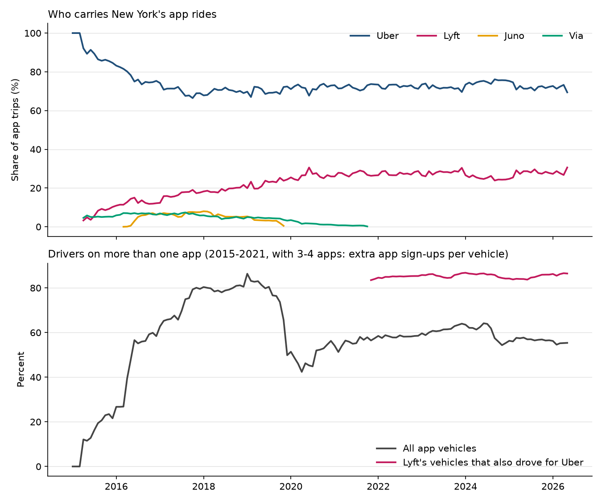
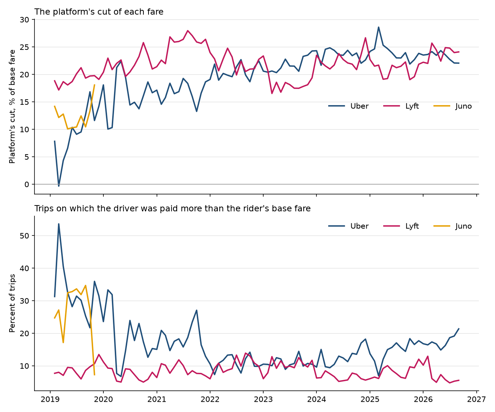

# Caillaud and Jullien (2003) on New York ride-hailing: findings

## In plain English

Caillaud and Jullien showed that when middlemen compete to connect two groups who each need the other, the
outcome depends on whether people can use more than one middleman. If they cannot, one firm wins everything and
earns nothing. If they can, two firms can survive with a profit, and the most profitable arrangement has the
bigger firm charging the smaller fee per trade. New York's ride-hailing records, 2015 to 2026, test this.

- **Drivers use both apps.** In 2025, 85% of the cars that drove for Lyft in a given month also drove for Uber,
  and 57% of all app cars drove for both. Uber carried 72% of trips and Lyft 28%.
- **Juno signed up drivers but never won riders.** Juno's fleet reached 21,994 cars, nearly a third of Uber's,
  but each Juno car got about a fifth as many trips as an Uber car. Juno closed in November 2019, and Via has no trips
  in the city's data after October 2021.
- **While there were three or four apps, Uber took the smaller cut.** In 2019 to 2021, within the same pickup zone
  and month, Uber kept 8.8 percentage points less of each fare than Lyft, and in 2019 it paid the driver more than
  the rider's base fare on a third of its trips. Pooled over 2023 to 2026 the two cuts are statistically the same,
  each between 18% and 24% a year, though single years differ by up to 3 points in either direction.
- **Lyft has never earned an operating profit.** From 2017 to 2025 it lost $9.6 billion on $33.0 billion of
  revenue, an operating margin of −29%; its best year, 2024, was −2.1%.

A friendlier tour is in the [README](../README.md). The rest of this page is every table the scripts produce.

**Key to the labels below.** *Cut* or *take rate* = 1 − driver pay ÷ base passenger fare, summed over trips.
*Subsidized trip* = a trip on which driver pay exceeded the base passenger fare. *Multihoming share* = (vehicles
counted by each company, summed) − (distinct vehicles doing any app trip), divided by distinct vehicles; with two
companies this is exactly the share of cars on both apps. *Within zone-month* = compared with the other company in
the same pickup zone and month, weighted by trips, standard errors clustered by pickup zone.

---

## Market structure and multihoming, by year

From `market_structure_by_year.csv` (TLC base aggregate report and monthly industry report).

| Year | Apps active | Uber trip share | Lyft trip share | Juno | Via | Mean HHI (trips) | Cars doing any app trip (monthly mean) | Multihoming share | Lyft's cars also on Uber |
|---|---|---|---|---|---|---|---|---|---|
| 2016 | 4 | 76.9% | 12.5% | 3.9% | 6.7% | 6,231 | 39,924 | 47.4% | |
| 2017 | 4 | 69.8% | 16.8% | 6.8% | 6.6% | 5,282 | 61,665 | 71.0% | |
| 2018 | 4 | 70.0% | 19.2% | 5.9% | 4.9% | 5,324 | 77,656 | 79.7% | |
| 2019 | 4 | 70.2% | 22.5% | 3.0% | 4.4% | 5,465 | 84,081 | 76.6% | |
| 2020 | 3 | 72.0% | 26.0% | | 2.0% | 5,866 | 50,639 | 49.4% | |
| 2021 | 3 | 72.2% | 27.3% | | 0.5% | 5,960 | 58,242 | 55.7% | 83.7% (Nov–Dec) |
| 2022 | 2 | 72.4% | 27.6% | | | 6,009 | 71,167 | 58.3% | 85.1% |
| 2023 | 2 | 71.9% | 28.1% | | | 5,964 | 77,833 | 61.3% | 85.6% |
| 2024 | 2 | 74.8% | 25.2% | | | 6,232 | 82,574 | 60.4% | 85.8% |
| 2025 | 2 | 72.2% | 27.8% | | | 5,994 | 81,581 | 56.9% | 84.7% |
| 2026 (Jan–May) | 2 | 71.8% | 28.2% | | | 5,953 | 84,118 | 55.3% | 86.2% |

With three or four companies (2016 to 2021) the multihoming share counts a car on k apps k − 1 times, so it is an
upper bound on the share of cars on more than one app. In May 2026: Uber 77,541 cars, Lyft 54,380, any app 84,907,
so 47,014 cars (55.4% of all, 86.5% of Lyft's) drove for both. Monthly values are in
`market_structure_monthly.csv`.

---

## Divide and conquer: trips per car relative to Uber

From `divide_and_conquer.csv`. Monthly log gap in trips per vehicle against Uber; mean with Newey–West standard
errors (12 lags).

| Company | Months | Trips per car ÷ Uber's | 95% CI | p | Fleet ÷ Uber's (mean) | Trips ÷ Uber's (mean) | Peak trip share |
|---|---|---|---|---|---|---|---|
| Lyft | 134 (2015-04 to 2026-05) | 0.477 | 0.452 to 0.504 | < 0.001 | 0.633 | 0.310 | 30.6% (2026-05) |
| Juno | 45 (2016-03 to 2019-11) | 0.205 | 0.135 to 0.313 | < 0.001 | 0.272 | 0.072 | 8.0% (2018-01) |
| Via | 79 (2015-04 to 2021-10) | 0.795 | 0.459 to 1.377 | 0.41 | 0.062 | 0.059 | 7.4% (2017-08) |

Juno's largest fleet was 21,994 cars in May 2018, against Uber's 70,054; its largest fleet relative to Uber's was
0.331. Via ran mostly pooled rides with a small fleet and is not a clean comparison.

---

## The platform's cut, by year

From `take_rate_by_year.csv` (TLC trip records, pooled requests excluded).

| Company | Year | Months | Trips | Fare per trip | Driver pay per trip | Cut per trip | Cut | Subsidized trips |
|---|---|---|---|---|---|---|---|---|
| Uber | 2019 | 11 | 133,009,484 | $18.96 | $17.16 | $1.80 | 9.5% | 33.2% |
| Uber | 2020 | 12 | 97,902,047 | $17.51 | $14.79 | $2.71 | 15.5% | 21.3% |
| Uber | 2021 | 12 | 125,166,776 | $21.94 | $18.25 | $3.69 | 16.8% | 18.4% |
| Uber | 2022 | 12 | 151,707,843 | $24.38 | $19.38 | $5.00 | 20.5% | 11.0% |
| Uber | 2023 | 12 | 161,405,103 | $25.52 | $19.96 | $5.56 | 21.8% | 10.9% |
| Uber | 2024 | 12 | 170,348,774 | $26.91 | $20.56 | $6.35 | 23.6% | 12.8% |
| Uber | 2025 | 12 | 169,019,854 | $28.02 | $21.25 | $6.77 | 24.2% | 14.6% |
| Uber | 2026 | 9 | 133,467,518 | $28.24 | $21.66 | $6.58 | 23.3% | 17.5% |
| Lyft | 2019 | 11 | 39,576,461 | $21.37 | $17.27 | $4.10 | 19.2% | 9.0% |
| Lyft | 2020 | 12 | 34,042,601 | $19.76 | $15.39 | $4.36 | 22.1% | 7.8% |
| Lyft | 2021 | 12 | 47,488,251 | $22.31 | $16.59 | $5.71 | 25.6% | 8.7% |
| Lyft | 2022 | 12 | 57,882,787 | $22.19 | $17.29 | $4.91 | 22.1% | 10.3% |
| Lyft | 2023 | 12 | 64,522,204 | $22.91 | $18.68 | $4.23 | 18.4% | 10.2% |
| Lyft | 2024 | 12 | 60,300,617 | $25.42 | $19.66 | $5.76 | 22.6% | 6.6% |
| Lyft | 2025 | 12 | 67,228,639 | $25.22 | $19.95 | $5.27 | 20.9% | 8.2% |
| Lyft | 2026 | 9 | 52,280,088 | $26.12 | $19.89 | $6.23 | 23.8% | 7.0% |
| Juno | 2019 | 10 | 6,379,081 | $17.24 | $15.17 | $2.07 | 12.0% | 28.4% |
| Via | 2019 | 11 | 141,021 | $19.96 | $16.53 | $3.43 | 17.2% | 21.2% |
| Via | 2020 | 12 | 890,278 | $26.31 | $16.41 | $9.90 | 37.6% | 1.1% |
| Via | 2021 | 10 | 359,101 | $31.40 | $18.26 | $13.14 | 41.8% | 1.4% |

2019 starts in February, the first month with fare and pay fields. Via's non-pooled trips are a small, unusual
slice of its business. Monthly values, with the 10th to 90th percentiles of the per-trip cut, are in
`take_rate_monthly.csv`.

---

## Within zone-month tests

From `fee_tests.csv`. Weighted least squares of the zone-month outcome on a company dummy with pickup zone ×
month fixed effects; cells need at least 100 trips for each company compared. Standard errors are clustered by
pickup zone unless the row says otherwise.

| Test | Outcome | Difference | SE | 95% CI | p | Cells | Reference mean |
|---|---|---|---|---|---|---|---|
| Uber − Lyft, 2019–2021 (3–4 apps) | Cut | −0.0881 | 0.0020 | −0.0920 to −0.0842 | < 0.001 | 17,806 | 0.2250 |
| Uber − Lyft, 2023–2026 (2 apps) | Cut | +0.0008 | 0.0046 | −0.0081 to +0.0098 | 0.86 | 23,090 | 0.2112 |
| Uber − Lyft, all months | Cut | −0.0278 | 0.0033 | −0.0343 to −0.0214 | < 0.001 | 47,024 | 0.2162 |
| Uber − Lyft, all months, clustered by month | Cut | −0.0278 | 0.0051 | −0.0378 to −0.0179 | < 0.001 | 47,024 | 0.2162 |
| Uber − Lyft, hour-of-day × month cells, clustered by month | Cut | −0.0158 | 0.0055 | −0.0266 to −0.0049 | 0.004 | 4,416 | 0.2173 |
| Uber − Lyft, all months | Subsidized share | +0.0778 | 0.0030 | +0.0720 to +0.0836 | < 0.001 | 47,024 | 0.0852 |
| Uber − Lyft, 2019 | Cut | −0.1052 | 0.0034 | −0.1119 to −0.0986 | < 0.001 | 5,600 | 0.1925 |
| Uber − Lyft, 2020 | Cut | −0.0672 | 0.0027 | −0.0724 to −0.0620 | < 0.001 | 6,074 | 0.2207 |
| Uber − Lyft, 2021 | Cut | −0.0882 | 0.0017 | −0.0915 to −0.0849 | < 0.001 | 6,132 | 0.2551 |
| Uber − Lyft, 2022 | Cut | −0.0196 | 0.0013 | −0.0221 to −0.0171 | < 0.001 | 6,128 | 0.2188 |
| Uber − Lyft, 2023 | Cut | +0.0210 | 0.0032 | +0.0147 to +0.0273 | < 0.001 | 6,160 | 0.1847 |
| Uber − Lyft, 2024 | Cut | −0.0069 | 0.0053 | −0.0172 to +0.0034 | 0.19 | 6,156 | 0.2257 |
| Uber − Lyft, 2025 | Cut | +0.0125 | 0.0051 | +0.0025 to +0.0225 | 0.015 | 6,148 | 0.2063 |
| Uber − Lyft, 2026 (Jan–Sep) | Cut | −0.0295 | 0.0048 | −0.0389 to −0.0202 | < 0.001 | 4,626 | 0.2334 |
| Juno − Uber, Feb–Oct 2019 | Subsidized share | −0.0455 | 0.0112 | −0.0674 to −0.0236 | < 0.001 | 6,324 | 0.3308 |
| Lyft − Uber, Feb–Oct 2019 | Subsidized share | −0.2418 | 0.0052 | −0.2520 to −0.2316 | < 0.001 | 6,324 | 0.3308 |
| Juno − Uber, Feb–Oct 2019 | Cut | +0.0310 | 0.0042 | +0.0228 to +0.0392 | < 0.001 | 6,324 | 0.0767 |
| Lyft − Uber, Feb–Oct 2019 | Cut | +0.1108 | 0.0025 | +0.1060 to +0.1157 | < 0.001 | 6,324 | 0.0767 |

The reference mean is the trip-weighted mean of the reference company's outcome in the cells used.

---

## Where the cut differs: boroughs in 2025

From `boroughs_last_full_year.csv`.

| Borough | Uber's share of trips | Uber's cut | Lyft's cut | Uber subsidized trips | Lyft subsidized trips |
|---|---|---|---|---|---|
| Manhattan | 71.2% | 31.0% | 23.0% | 9.0% | 7.0% |
| Queens | 71.7% | 20.5% | 19.3% | 17.0% | 8.5% |
| Brooklyn | 70.1% | 19.0% | 19.9% | 16.4% | 9.1% |
| Staten Island | 76.0% | 16.8% | 21.5% | 18.8% | 6.5% |
| Bronx | 74.6% | 13.3% | 18.0% | 22.2% | 10.1% |

---

## Extension: Lyft's operating results

From `lyft_profits.csv` and `lyft_profits_summary.csv` (inline XBRL of Lyft's 10-K filings for fiscal 2019, 2022
and 2025).

| Year | Revenue | Operating income | Operating margin | Net income |
|---|---|---|---|---|
| 2017 | $1,059.9M | −$708.3M | −66.8% | −$688.3M |
| 2018 | $2,156.6M | −$977.7M | −45.3% | −$911.3M |
| 2019 | $3,616.0M | −$2,702.5M | −74.7% | −$2,602.2M |
| 2020 | $2,364.7M | −$1,808.4M | −76.5% | −$1,752.9M |
| 2021 | $3,208.3M | −$1,135.2M | −35.4% | −$1,062.1M |
| 2022 | $4,095.1M | −$1,458.9M | −35.6% | −$1,584.5M |
| 2023 | $4,403.6M | −$475.6M | −10.8% | −$340.3M |
| 2024 | $5,786.0M | −$118.9M | −2.1% | $22.8M |
| 2025 | $6,316.3M | −$188.4M | −3.0% | $2,844.0M |

Cumulative 2017–2025: revenue $33.0 billion, operating loss $9.57 billion, margin −29.0%; −59.1% over 2017–2021
and −10.9% over 2022–2025. Lyft's 2025 net income includes a one-time release of a tax valuation allowance, which
is why operating income is the measure used.

---

## Sample

| | Value |
|---|---|
| Monthly company tables | January 2015 to May 2026, 137 months |
| Trip record files | February 2019 to September 2026, 92 months |
| Trip records read | 1,669,677,414 |
| Dropped: pooled (shared) requests | 87,759,935 |
| Dropped: non-positive fare, driver pay, miles or time | 8,798,951 |
| Trips kept | 1,573,118,528 |
| Pickup zones used in the Uber–Lyft test | 257 |

The non-positive drops include whole days in 2019 when Uber's driver pay field is empty (for example August 1 to
4 and August 19, 2019); those days drop out of both fare and pay, so they do not bias the cut. Per-month counts
are in `../data/processed/trips_build_log.csv`.

Data: NYC Taxi and Limousine Commission High Volume For-Hire Vehicle trip records, FHV Base Aggregate Report
(NYC Open Data 2v9c-2k7f) and monthly industry report, all downloaded 2026-11-01; Lyft 10-K inline XBRL from
Lyft's investor-relations filing archive, downloaded 2026-11-01.
